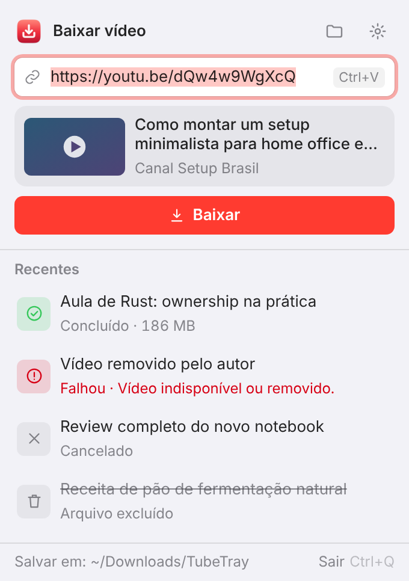

<p align="center">
  
</p>

<h1 align="center">TubeTray</h1>

<p align="center">
  Copie o link, clique no ícone da bandeja e baixe o vídeo em MP4.<br />
  Windows e macOS · gratuito, sem anúncios e de código aberto.
</p>

<p align="center">
  <a href="https://github.com/GuiRoger/tube-tray/releases/latest"></a>
  <a href="LICENSE"></a>
  <a href="https://github.com/sponsors/GuiRoger"></a>
</p>

<p align="center">
  <a href="https://tubetray.vercel.app/">Site</a> ·
  <a href="#baixar">Baixar</a> ·
  <a href="#apoie-o-desenvolvedor">Apoiar</a> ·
  <a href="#para-desenvolvedores">Desenvolver</a>
</p>

<p align="center">
  
</p>

O TubeTray fica na bandeja do Windows ou na barra de menu do Mac. Copie o link de um vídeo do YouTube, clique no ícone e ele já aparece colado, com miniatura, título e canal. Um clique em **Baixar** e o MP4 (H.264 + AAC) cai na pasta `Downloads/TubeTray`, com uma notificação quando termina. Por baixo, ele usa o [yt-dlp](https://github.com/yt-dlp/yt-dlp) e o [FFmpeg](https://ffmpeg.org).

> **Use com responsabilidade.** Baixe apenas conteúdo que você tem direito de baixar: seus próprios vídeos, conteúdos com licença livre ou com permissão de quem os criou.

## Baixar

Os links abaixo baixam direto o instalador da **última versão**:

| Sistema | Instalador |
|---|---|
| Windows 10 e 11 (64 bits) | [TubeTray-windows-x64-setup.exe](https://github.com/GuiRoger/tube-tray/releases/latest/download/TubeTray-windows-x64-setup.exe) |
| macOS 11+ com chip Apple (M1 a M4) | [TubeTray-macos-apple-silicon.dmg](https://github.com/GuiRoger/tube-tray/releases/latest/download/TubeTray-macos-apple-silicon.dmg) |
| macOS 11+ com processador Intel | [TubeTray-macos-intel.dmg](https://github.com/GuiRoger/tube-tray/releases/latest/download/TubeTray-macos-intel.dmg) |

Versões anteriores e notas de cada versão: [Releases](https://github.com/GuiRoger/tube-tray/releases). O TubeTray é distribuído só pelo GitHub e pelo [site](https://tubetray.vercel.app/); ele não está na Microsoft Store nem na Mac App Store.

### Instalar no Windows

Abra o `TubeTray-windows-x64-setup.exe`. Se o SmartScreen avisar, clique em *Mais informações → Executar assim mesmo* (o instalador ainda não tem assinatura de código). O ícone vermelho aparece na bandeja, perto do relógio.

### Instalar no Mac

1. Baixe o `.dmg` do seu Mac: **Apple Silicon** (M1 a M4) ou **Intel** ( → Sobre este Mac).
2. Abra o `.dmg` e arraste o TubeTray para **Aplicativos**.
3. No Terminal, rode uma vez: `xattr -cr /Applications/TubeTray.app`
   (sem isso o macOS diz que o app "está danificado", porque ele não tem assinatura da Apple).
4. Abra o TubeTray: o ícone aparece na barra de menu. Na primeira notificação, permita notificações para o app.

## Como usar

1. Copie o link do vídeo (`youtube.com/watch`, `youtu.be`, Shorts ou live gravada).
2. Clique no ícone do TubeTray: o link já vem colado, com a prévia do vídeo.
3. Clique em **Baixar** (ou Enter). Pode fechar a janela: o progresso aparece no próprio ícone.

Mais coisas que ele faz:

- Fila: cole vários links seguidos; eles baixam um por vez. Dá para cancelar e tentar de novo.
- Histórico dos últimos 100 downloads, com atalhos para abrir o vídeo ou mostrá-lo na pasta. Se você apagar um arquivo, ele aparece riscado, com a opção de baixar de novo.
- Notificação do sistema ao concluir ou falhar, com o título do vídeo.
- Ajustes: pasta de destino, abrir ao iniciar sessão, detectar link copiado, notificações e atualização do yt-dlp com um clique.
- Tema claro e escuro, atalhos `Esc`, `Ctrl/⌘ + O` (pasta), `Ctrl/⌘ + ,` (ajustes) e `Ctrl/⌘ + Q` (sair).

## Apoie o desenvolvedor

<a href="https://github.com/sponsors/GuiRoger"></a>

O TubeTray é gratuito e continua assim, sem nada travado e sem anúncios. Se ele te ajuda, você pode apoiar o desenvolvimento pelo [GitHub Sponsors](https://github.com/sponsors/GuiRoger), se quiser. Apoiar é opcional e não libera nenhum recurso. Dar uma ⭐ no repositório também ajuda.

---

## Para desenvolvedores

Stack: **Tauri 2** (núcleo em Rust) + **React/TypeScript** (Vite). Visual conforme [`design/DESIGN_SYSTEM.md`](design/DESIGN_SYSTEM.md). O plano do projeto e o **checklist de validação** de cada versão ficam em [`docs/PLANO.md`](docs/PLANO.md).

O download usa o mesmo resultado deste comando:

```
yt-dlp -S "vcodec:h264,res,acodec:m4a" --merge-output-format mp4 "<link>"
```

### Pré-requisitos (uma vez)

| | Windows | macOS |
|---|---|---|
| Rust | [rustup](https://rustup.rs) (toolchain `stable-msvc`) | `curl https://sh.rustup.rs -sSf \| sh` |
| Compilador | **Visual Studio Build Tools** com "Desenvolvimento para desktop com C++" | `xcode-select --install` |
| WebView | WebView2 (já vem no Windows 11) | nativo |
| Node.js | 20 ou mais | 20 ou mais |

Detalhes: <https://v2.tauri.app/start/prerequisites/>

### Rodar

```bash
npm install
npm run fetch:ffmpeg      # baixa o ffmpeg da sua plataforma para src-tauri/binaries/
npm run tauri dev         # abre o app (ícone aparece na bandeja)
```

O **yt-dlp** não vem no repositório: o app baixa a versão mais recente do GitHub no primeiro download e guarda na pasta de dados (`%APPDATA%\io.github.guiroger.tubetray\bin` / `~/Library/Application Support/io.github.guiroger.tubetray/bin`). Em *Ajustes → Avançado* há o botão **Atualizar**.

Ver só a interface no navegador, sem Rust (dados simulados):

```bash
npm run dev:mock          # http://localhost:1420/?s=list | empty | notice | invalid | settings | preview | licenses
```

### Publicar uma versão

```bash
git tag v0.1.2
git push --tags
```

O workflow [`.github/workflows/build.yml`](.github/workflows/build.yml) pega a versão da tag (não precisa editar arquivos), roda os testes, gera os instaladores de Windows, Mac Apple Silicon e Mac Intel, sobe também as cópias com nome fixo (`TubeTray-windows-x64-setup.exe`, `TubeTray-macos-apple-silicon.dmg`, `TubeTray-macos-intel.dmg`) e, quando os três terminam, **publica o release** como *Latest*. A partir daí os links de [Baixar](#baixar) e os botões do site baixam essa versão direto. Leva uns 15 minutos.

Para gerar só os instaladores, sem release: *Actions → build → Run workflow* (ficam em *Artifacts*). Localmente: `npm run tauri build`.

### Testes

```bash
npm test                  # formatação (vitest)
npx tsc -b                # tipos
npm run test:core         # núcleo Rust: URL, progresso, fila, histórico, settings
```

Testes com o yt-dlp real contra um servidor HTTP local:

```bash
TT_YTDLP=/caminho/yt-dlp TT_CLIP_URL=http://127.0.0.1:8765/clip.mp4 cargo test --manifest-path src-tauri/core/Cargo.toml --test real_ytdlp
```

### Estrutura

```
src/                      UI React
  components/             Header, UrlForm, VideoPreview, DownloadList/Row, Footer, Settings, Licenses
  styles/tokens.css       tokens do design system (claro/escuro/alto contraste)
  assets/icons/           ícones de UI do design system
  assets/licenses/        textos das licenças + lista de componentes (npm run licenses)
  lib/tauri.ts            comandos e eventos tipados
  lib/support.ts          links de apoio (Sponsors, Pix opcional)
  dev/mock.ts             simulação do núcleo para `dev:mock`
src-tauri/
  core/                   crate sem UI: fila, runner do yt-dlp, progresso, histórico, prévia, settings
  src/                    app Tauri: bandeja, janela popover, notificações, comandos
  icons/                  ícone do app, bandeja (windows/, macos/) e notificação
scripts/                  fetch-ffmpeg.mjs, third-party.mjs
design/                   design system e gerador de ícones
docs/PLANO.md             escopo, status e checklist de validação
```

### Como funciona

- O núcleo chama o yt-dlp com o perfil acima e pede linhas próprias de progresso (`--progress-template`, `--print`, `--encoding utf-8`), em vez de interpretar a saída de texto. Vídeo e áudio viram uma barra só.
- Um download por vez; os outros ficam na fila. Cancelar encerra o yt-dlp e o ffmpeg e apaga os temporários.
- Arquivos saem como `Título [id].mp4` na pasta escolhida. O id no nome permite achar o arquivo mesmo se o caminho informado vier com acentos corrompidos.
- A prévia usa o oEmbed do YouTube (sem chave de API).
- O histórico fica em `history.json` (últimos 100) e os ajustes em `settings.json`, na pasta de dados do app.
- A página do projeto ([tubetray.vercel.app](https://tubetray.vercel.app/)) fica num repositório separado (`tube-tray-landing-page`).

### Próximos passos

Escolha Vídeo/Áudio e qualidade, playlists, pausar/retomar, downloads simultâneos, atalho global, auto-update do app, assinatura de código.

## Licença

Código do TubeTray: [MIT](LICENSE). O FFmpeg (GPL-3.0, embutido nos instaladores) e o yt-dlp (baixado no primeiro uso) mantêm suas licenças; veja [THIRD_PARTY_NOTICES.md](THIRD_PARTY_NOTICES.md) e, no app, *Ajustes → Sobre → Licenças*.

Projeto independente, sem afiliação com o YouTube ou o Google. YouTube é marca registrada da Google LLC.
